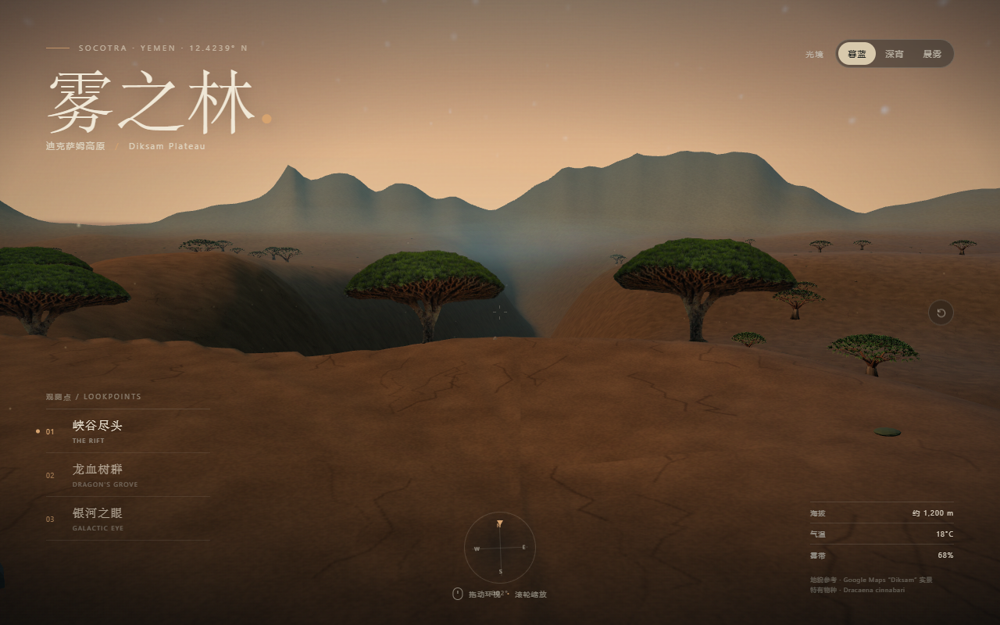
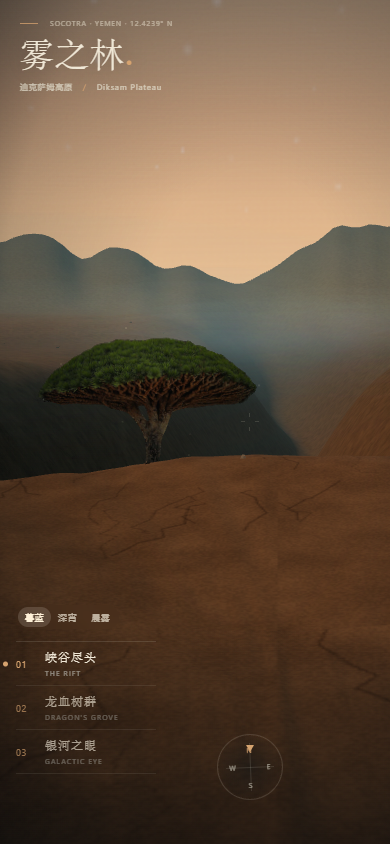
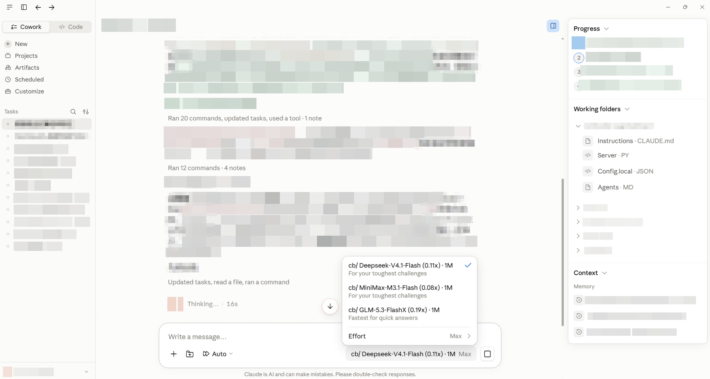
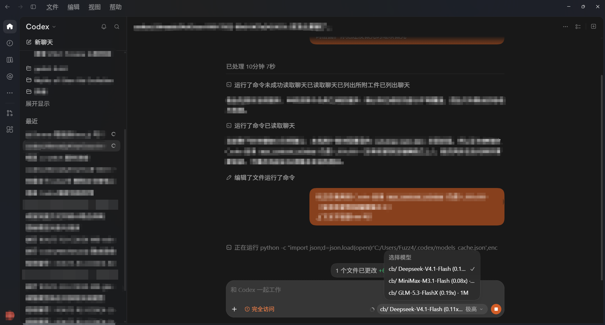

# cb-wb-cc-路由

GitHub 仓库：[`zhuofupan/cb-wb-cc-routing`](https://github.com/zhuofupan/cb-wb-cc-routing)。

用 CC Switch 将 **DeepSeek 官方、CodeBuddy、WorkBuddy** 接入 **Claude Desktop 的 Code / Cowork**，并保留 Claude Code / Codex 的协议适配示例。目标是更换模型与额度来源，同时继续使用客户端的文件工具、Skills、MCP 和插件；不是把厂商聊天界面搬过来。

2026-10-21 更新：CodeBuddy / WorkBuddy 默认仅保留三款，顺序为 DeepSeek、MiniMax、GLM FlashX，默认使用 DeepSeek。Kimi 和 GLM-5.3 仅在用户明确要求时配置。名称格式为 `cb/ 模型名 (倍率x) · 上下文` / `wb/ 模型名 (倍率x) · 上下文`。两端的五档都保留为可选，网关按上游真实档位取最近档（DeepSeek/GLM 的 medium→low、xhigh→high）；客户端没发档位时沿用同一客户端上次的选择。用户已确认当前功能测试完成；证据及历史限制见[验证记录](references/validation-20261021.md)。

## 用户实践案例

用户提供了 **DeepSeek + Claude 的罗赖马山全景**、**DeepSeek + Codex 的 Diksam 全景**，以及两端模型菜单的已打码截图。见[案例、作品预览与配置截图](references/panorama-cases.md)。作品来源按用户说明记录；配置截图展示选中模型与档位，完整运行、实际路由和满窗口能力分别验收。

### 作品预览：DeepSeek + Codex

**雾之林 · Diksam 360°**，项目自带的桌面与移动端预览。





DeepSeek + Claude 的**罗赖马山 · 失落的世界**已记录到案例页，当前尚无作品预览图。

### 配置截图：Claude Desktop / Cowork

三模型菜单、DeepSeek 选中状态和 Max 档位：



### 配置截图：Codex Desktop

三模型菜单、DeepSeek 选中状态和“极高”档位：



## 认证与依赖

| 通路 | 用户提供什么 | 本地依赖 |
|---|---|---|
| DeepSeek 官方 | 自己的 API key | Desktop 模型映射使用 CC Switch；推理直接发官方接口 |
| CodeBuddy | 自己的 `ck_…` API key | CC Switch + 18792 适配器；不需要 WorkBuddy 登录或 DSH |
| WorkBuddy | 自己的桌面登录态、本地随机令牌 | CC Switch + 18791 适配器 + WorkBuddy 可用安装 + DSH 认证源码 |

```text
Claude Desktop Code / Cowork → CC Switch :15721
  ├─ DeepSeek 官方 Anthropic 兼容端点
  ├─ :18792 CodeBuddy → 腾讯上游（用户 ck key）
  └─ :18791 WorkBuddy → 腾讯上游（用户登录态）
```

CodeBuddy 的“只需 key”指认证，不表示 Claude Desktop 原生提供了任意 API key 输入框。WorkBuddy 原生生图、搜索、抓取 MCP 是**可选补充**，另需 WorkBuddy 登录和额度，不属于 CodeBuddy key 附赠能力。

## 默认三个模型

名称使用小写 `cb/ ` / `wb/ ` 前缀。目录自动刷新、Codex 强度显示与安全运行统计见[配置说明](references/catalog-and-statistics.md)。

| 模型（用户指定顺序） | 上游 ID | 倍率 | 目录声明上下文 |
|---|---|---:|---:|
| DeepSeek-V4.1-Flash | `deepseek-v4.1-flash` | 0.11x | 1M |
| MiniMax-M3.1-Flash | `minimax-m3.1-flash` | 0.08x | 1M |
| GLM-5.3-FlashX | `glm-5.3-flashx` | 0.19x | 1M |

倍率与上下文于 2026-10-21 核对 WorkBuddy 账号目录，倍率可能随活动及账号变化，非固定 API 价格。此顺序按用户偏好，不是按倍率数值排序。DeepSeek Pro、Space-Bunny、Hy4、Step-5、Xiaomi MiMo 已从当前菜单移除；历史测试保留。DeepSeek 官方菜单仅保留 `deepseek-flash`（V4.1-Flash，声明 1048576 token）。

## 启动适配器

需要 Node.js 24（本次实测版本 24.15.0）、Python 3 和 Windows PowerShell。

CodeBuddy 可独立安装，不必安装 WorkBuddy：

```powershell
Copy-Item scripts/codebuddy-settings.json.example scripts/codebuddy-settings.json
powershell -File scripts/start-workbuddy.ps1 -SettingsPath scripts/codebuddy-settings.json
```

WorkBuddy 路由另需 DSH 的认证模块：

```powershell
git clone https://github.com/corrinehu/dsh-workbuddy-connect scripts/dsh-workbuddy-connect
# 本次验证的认证源码版本；升级认证模块后重新验收。
git -C scripts/dsh-workbuddy-connect checkout 9e2d2559119e93113097554adacc52d62aef7882
npm.cmd install --omit=dev
Copy-Item scripts/local-settings.json.example scripts/local-settings.json
# 编辑 local-settings.json：填写自己的 WorkBuddy.exe 路径与随机 secret。
powershell -File scripts/start-workbuddy.ps1
```

前台诊断也可运行 `node --experimental-strip-types scripts/gateway-server.mjs --settings scripts/codebuddy-settings.json`。常驻需使用自己的计划任务/进程管理器；验证端口实际存活，不能把一次 Start-Process 成功等同于会话退出后仍常驻。配置示例关闭按 CLI 活跃状态自动退出，适用于只使用 Desktop 的场景。

认证依赖是可选依赖，仅 WorkBuddy/MCP 使用；CodeBuddy 不需要执行上述 clone 或 npm 安装。WorkBuddy 如提示缺少 `@deepseek-ai/dsh-atomic-write` 或 `@deepseek-ai/dsh-home-paths`，应确认两项依赖安装成功，不能把模块缺失当成账号认证失败。

## 注册 Desktop 供应商

先从托盘退出 CC Switch。脚本只注册/更新对应供应商，会备份数据库，保留已有供应商的选中状态，不为每模型建卡片，也不直接修改 live-state。

```powershell
# 先在当前终端安全设置自己的 CODEBUDDY_API_KEY、WORKBUDDY_LOCAL_SECRET 或 DEEPSEEK_API_KEY。
# 不要把真实值写入仓库、截图或 issue。
python scripts/register-ccswitch-desktop.py --provider codebuddy
python scripts/register-ccswitch-desktop.py --provider workbuddy
python scripts/register-ccswitch-desktop.py --provider deepseek
```

默认数据库为 `~/.cc-switch/cc-switch.db`，可用 `CCSWITCH_DB` 指定位置。只需更新已存在的腾讯模型菜单时运行 `python scripts/setup-claude-model-routes.py --provider all`。如果已有不同 ID 的 DeepSeek 供应商，应更新已有条目，避免重复注册。

打开 CC Switch，在 **Claude Desktop** 页启用相应厂商，再完全退出并打开 Claude Desktop。保持 profile 可写；`meta.claudeDesktopModelRoutes`、`labelOverride`、`supports1m` 必须使用 camelCase。旧版文档根据 snake_case 搜索误判“不支持映射”，并建议只读 profile，已纠正。

默认流程只配置 **Claude Desktop**。Claude Code（CC Switch 的 Claude 页，`app_type='claude'`）是另一套配置，仅在明确要求时运行 `python scripts/register-ccswitch-claude.py --provider codebuddy|workbuddy`；两边不要因同名而混写。

## 上下文与最高思考

窗口声明、压缩阈值、客户端显示、实际长请求容量是不同证据。每模型设置示例、Cowork 隔离目录和 SDK audit 的判断边界见 [上下文](references/context-window.md)。没有进行满 1M token 负载测试。

单次输出上限与输入窗口分开计算：当前 DeepSeek/MiniMax 各 128000、GLM 131072。代理在客户端未声明 `max_tokens` / `max_output_tokens` 时使用该模型上限，并按剩余窗口收敛，不再退回 16K/8K。Codex 与 Desktop 使用当前客户端的原生默认压缩策略。详见[输出预算](references/context-window.md#输出预算2026-10-21-修正)。

示例使用 `effortPolicy: "client"`：客户端选择哪一档就发哪一档，没有选择时用上次同模型的选择，首次则用上游默认档。Codex 目录和 Claude 选择器都提供 low/medium/high/xhigh/max 五档，并在说明中标注实际上游档位。请求 200 不证明供应商内部执行了对应计算量，详见 [思考档位](references/reasoning-effort.md)。

Claude Desktop 的 Code 与 Cowork 分开记住模型和思考选择。默认不强写 Max 环境变量或 Windows 策略。若历史配置有强制覆盖，可先从托盘退出 CC Switch，再运行 `python scripts/optimize-claude-desktop.py` 预览、加 `--apply` 备份并更新。已有受保护的 Windows 初始默认策略可能保留，不能把设置文件写入当作界面验收。

工具按需加载、等待边界与生效限制分别见 [Codex 原生接入](references/native-integration.md)、[Claude Desktop 原生适配](references/claude-desktop-native.md)。更新 Desktop 设置后需要重新启动客户端；这不会立即缩短现有长聊天。

## 原生工具与插件

优先使用 Claude / Codex 自带工具和已安装插件。模型负责选择工具，客户端负责文件、命令、MCP 执行。本地函数协议通过，不代表全部官方服务端能力自动可用。

本机 Desktop Code 内置 WebSearch 曾因参数不兼容失败，已修复通用强制函数选择参数；但未把该修复冒充 WebSearch 已复验通过。内置 WebFetch 曾因 claude.ai 域名检查失败。可选 WorkBuddy MCP 的搜索/抓取在两个 Desktop 模式真实调用成功，但它不是原生工具已修好的证明。插件机制、认证边界与生图安装见 [工具与插件](references/tools-and-plugins.md)。

## 测试与读取路由

```powershell
node --test tests/*.test.mjs
python -m unittest discover -s tests -p "test_*.py"
powershell -NoProfile -File tests/supervisor.test.ps1
```

这些离线回归测试不使用真实 key、不消耗模型额度；实际在线/客户端测试覆盖见 [实测记录](references/desktop-validation.md)。[SKILL.md](SKILL.md) 是给 agent 的读取路由。

Codex 新版注册脚本支持三个厂商、模型目录与最高档默认值；配置方法见 [Codex 应用配置](references/codex-isolation.md)。本轮用户已确认客户端功能测试完成，离线回归与接口探针另行记录，不据此推断满 1M 负载能力。更多记录：[模型菜单](references/model-menu.md)、[CC Switch 内部](references/cc-switch-internals.md)、[限制](references/limits.md)、[排错](references/troubleshooting.md)。

## 来源与许可

- DSH 认证源码：[corrinehu/dsh-workbuddy-connect](https://github.com/corrinehu/dsh-workbuddy-connect)（MIT，另行安装）。
- [DeepSeek 模型目录](https://api-docs.deepseek.com/api/list-models/)、[思考模式](https://api-docs.deepseek.com/guides/thinking_mode/)。
- [CC Switch Desktop 文档](https://github.com/farion1231/cc-switch/blob/main/docs/user-manual/en/2-providers/2.6-claude-desktop.md)。
- 本仓库 MIT。只提交源码、占位符模板及脱敏结论，不提交登录态、数据库、失败请求正文、签名图片 URL 或个人日志。
